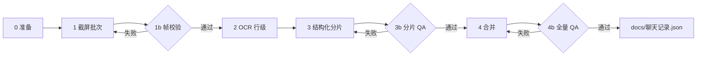

# 微信聊天记录导入流水线

将 **PC 微信聊天窗口截图** 转为 MetaSelf 使用的 `docs/聊天记录.json`。本流水线以 **可验证的中间产物** 为准，禁止用模型「按天补全」或「概括整段聊天」。

## 目标产物

```json
{
  "self": "我",
  "contact": "对方备注名",
  "meta": {
    "pipelineVersion": 1,
    "builtAt": "2026-10-14T12:00:00+08:00",
    "batches": ["batch-20260707-a", "batch-20260722-b"]
  },
  "messages": [
    { "from": "self", "at": "2026年07月07日17:15", "kind": "text", "text": "你好" }
  ]
}
```

| 字段 | 含义 |
|------|------|
| `from` | `self` = 截图里 **右侧绿色气泡**；`contact` = **左侧白色气泡** |
| `at` | `yyyy年MM月dd日HH:mm`，与微信时间条一致 |
| `kind` | `text` \| `sticker` \| `image` \| `voice` \| `video` \| `link` \| `system` |
| `text` | 正文；表情包统一写 `表情包`，图片写 `图片` |

每条来自截图的消息应在分片 JSON 里保留溯源（合并时可写入 `meta`，消息级可选 `sourceFrame`）。

---

## 总览（阶段与闸门）



**硬性规则（违反即不得合并进最终文件）：**

1. **禁止** 生成 `final-jul-*` 一类「按天生成的日程模板」JSON。
2. **禁止** 用 LLM 填补截图未覆盖的日期；缺口保留在 `meta.gaps`，后续用新批次补截。
3. **禁止** 把 `jul-mine`（己方视角）与 `contact` 视角片段在不做时间对齐的情况下对调 `from`。
4. 截屏批次内任意相邻两帧 **文件哈希不得相同**。
5. 合并前每个分片必须通过 `qa-fragment.ps1`；合并后必须通过 `qa-export.ps1`。

---

## 阶段 0：准备

| 项 | 要求 |
|----|------|
| 环境 | Windows 10/11，PC 微信已登录，显示器缩放建议 100% |
| 工作目录 | 仓库外临时目录即可，例如 `%TEMP%\wx-run\<batch-id>\` |
| 批次 ID | `batch-<yyyyMMdd>-<序号>`，例如 `batch-20260722-01` |
| 聊天 | 打开与 **单一联系人** 的对话框；标题栏窗口名为「微信」 |

在批次目录创建 `manifest.json`（也可用 `scripts\new-batch.ps1` 生成）：

```json
{
  "batchId": "batch-20260722-01",
  "contact": "邵冰婵",
  "capture": { "frames": 8, "scrollDelta": -300 },
  "timeRangeHint": { "from": "2026-07-22", "to": "2026-07-22" }
}
```

---

## 阶段 1：截屏批次

**脚本：** `scripts/capture.ps1`

1. 定位微信主窗口，固定位置与大小（与脚本内参数一致，勿中途改缩放）。
2. 鼠标置于 **聊天消息区域**，先向上滚动 `PreScroll` 次，再按帧截屏并向下滚动。
3. 每帧保存为 `frames/00.png` … `frames/07.png`。

**脚本：** `scripts/validate-frames.ps1`（闸门 **1b**）

- 计算每帧 MD5；任意相邻帧相同 → **整批作废**，不得进入 OCR。
- 可选：相邻帧中心区域像素差低于阈值 → 警告或作废（滚动未生效）。

典型失败原因（你之前在 `wx-batch` 遇到的）：窗口失焦、滚轮事件未落在聊天区、6 帧全是同一张图。

---

## 阶段 2：OCR（行级，带坐标）

**原则：** OCR 只产出 **「这一帧里看见了什么字、在什么位置」**，不产出 `from` / 不编造下一句。

推荐工具链（与现有临时脚本一致）：

- Windows.Media.Ocr（`zh-Hans`）
- 对每帧输出 `ocr/<nn>.json`：

```json
{
  "frame": "03.png",
  "lines": [
    { "text": "你好", "x": 412, "y": 88, "w": 120, "h": 28 }
  ]
}
```

**脚本：** 可继续用本机 `%TEMP%\wx-batch2\ocr.ps1` 单图模式；流水线要求把结果 **落盘到批次目录**，不要只在控制台打印。

**重叠区：** 相邻帧会有重复气泡。重复消解放在阶段 4 合并，不在 OCR 阶段删光（避免误删单帧内合法重复句）。

---

## 阶段 3：结构化分片（人工 + 半自动）

**产物：** `fragments/<batch-id>.json` — 消息数组，且带批次头：

```json
{
  "batchId": "batch-20260722-01",
  "contact": "邵冰婵",
  "source": "screenshot+ocr",
  "messages": [ /* 同上文 message 形状 */ ]
}
```

### 说话人判定（固定规则）

| 气泡位置（PC 微信） | `from` |
|---------------------|--------|
| 右侧、绿色 | `self` |
| 左侧、白色/灰色 | `contact` |

用 OCR 行的 `x` 与截图宽度中线比较；中线附近 ambiguous 的行标为 `kind: "system"` 或进 `review.txt` 人工确认，**不要猜**。

### 时间

- 只使用截图里出现的 **时间条** 文字；没有时间条的消息继承本帧内上一条时间条。
- **不要** 为「凑满一天」而均匀生成 08:00、12:00、22:00。

### 允许的人工方式

| 方式 | 适用 |
|------|------|
| 对照截图逐段录入 | 最可靠 |
| 编辑器根据 `ocr/*.json` + 截图填 `messages` | 推荐 |
| 多模态模型 **逐帧** 转 JSON，且保留 `sourceFrame` | 可用，需人工 spot-check |

### 禁止

- 「帮我生成 7 月 7 日到 7 月 15 日每天聊天」→ 会产生旧版 `final-jul-*` 式假数据。
- 把 `jul-mine-*.json` 整体反转 `self`/`contact` 当作对方视角。

**闸门 3b：** `scripts/qa-fragment.ps1` — 见下文 QA 节。

---

## 阶段 4：合并

**脚本：** `scripts/merge-export.ps1`

输入：`manifest.list`（每行一个 `fragments/*.json` 路径），或 `-Fragments` 参数。

合并逻辑（顺序）：

1. 解析 `at` 为时间戳，**全局按时间排序**（禁止「把补全块 prepend 到旧文件」这种未排序拼接）。
2. **精确去重：** 键 `from|at|text`。
3. **跨帧去重（重叠滚动）：** 若两条消息 `text` 相同、`from` 相同，且时间差 ≤ 2 分钟，保留一条（保留 `sourceFrame` 更早或 OCR 置信更高者）。
4. 同一秒内多条合法消息（连发）**全部保留**。
5. 写出 `docs/聊天记录.json`，并写 `meta.batches`、`meta.gaps`（若某段时间无分片覆盖则记录，不填充）。

**不要** 读取或合并任何匹配 `final-jul-*.json`、`synthetic-*.json` 的文件（合并脚本默认拒绝）。

---

## 阶段 5：全量 QA

**脚本：** `scripts/qa-export.ps1`

| 检查 | 失败条件 |
|------|----------|
| 时间单调 | 解析后任一条早于前一条 |
| 模板句占比 | 「早/去吧/好/晚安/到达/表情包/准备去吃饭…」等短句占比 **> 40%** 且存在连续 6 条模板序列 ≥ 3 次 |
| 重复三元组 | 无（合并后不应有完全相同的 from+at+text） |
| 单日异常密度 | 某日消息数 > 200 且无 `meta.allowDenseDay` |
| 溯源 | `meta.pipelineVersion` 存在 |

QA 报告写入 `docs/wechat-chat-import/reports/qa-<timestamp>.txt`。失败时 **不覆盖** `docs/聊天记录.json`（除非 `-Force`）。

---

## 目录约定（单次运行）

```text
%TEMP%\wx-run\batch-20260722-01\
  manifest.json
  frames\00.png …
  ocr\00.json …
  fragments\batch-20260722-01.json
  qa-fragment.txt
```

仓库内：

```text
docs/wechat-chat-import/
  PIPELINE.md          # 本文
  manifest.list.example
  scripts\*.ps1
  reports\             # QA 输出（可 gitignore）
docs/聊天记录.json      # 仅 QA 通过后由 merge-export 写入
```

---

## 与错误旧流程的对照

| 旧做法 | 问题 | 本流水线 |
|--------|------|----------|
| `wx-batch` 30 张相同 PNG | 截屏/滚动失败未发现 | `validate-frames.ps1` 闸门 |
| `final-jul-*.json` 按天编造 | 816 条里 200+ 条假对话 | **禁止**；缺口记入 `meta.gaps` |
| `wx-merge.ps1` 把补全块拼到前面 | 顺序/来源混乱 | 按时间全局排序 + 分片 manifest |
| `from\|at\|text` 去重 | 跨天模板去不掉 | + 模板 QA + 禁止合成文件 |
| `jul-mine` 与导出角色相反 | 谁先说「准备去工位」颠倒 | 固定「右绿=self」规则 |

---

## 推荐操作顺序（命令）

在 PowerShell 中（路径按实际批次修改）：

```powershell
$batch = "$env:TEMP\wx-run\batch-20260722-01"
& "e:\Hangyu\VibeCoding\React\meta-self\docs\wechat-chat-import\scripts\new-batch.ps1" `
  -BatchDir $batch -Contact "邵冰婵"

& "...\scripts\capture.ps1" -Dir (Join-Path $batch "frames")

& "...\scripts\validate-frames.ps1" -Dir (Join-Path $batch "frames")

# OCR → 人工/半自动编辑 fragments\*.json

& "...\scripts\qa-fragment.ps1" -Fragment (Join-Path $batch "fragments\batch-20260722-01.json")

& "...\scripts\merge-export.ps1" `
  -ManifestList "e:\Hangyu\VibeCoding\React\meta-self\docs\wechat-chat-import\manifest.list"

& "...\scripts\qa-export.ps1" -Export "e:\Hangyu\VibeCoding\React\meta-self\docs\聊天记录.json"
```

---

## 后续接入 MetaSelf

`src/app/(main)/library/chat/page.tsx` 当前为占位。导入 JSON 稳定后可增加：读取 `docs/聊天记录.json` 或迁入 Prisma `ChatMessage` 表；本流水线 **不依赖** 数据库即可先跑通。

---

## 脚本说明

- 脚本为 **Windows PowerShell 5.1** 编写；`_date.ps1` 等核心逻辑使用 ASCII / `\uXXXX`，避免无 BOM 的 UTF-8 在中文系统上被误读为 ANSI。
- 模板词表在 `scripts/template-words.json`（UTF-8），由 QA 脚本读取。

## 修订记录

| 日期 | 说明 |
|------|------|
| 2026-10-14 | 初版：基于 `wx-batch` / `final-jul` 事故归纳 |
